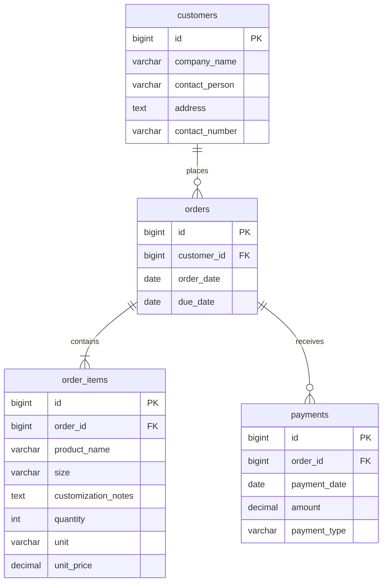

# Order Management System Database Schema

This schema covers packaging orders through **Input Payment Details** in [process-flow.jpg](process-flow.jpg). It is implemented by four Laravel migrations applied to the configured MySQL database.

The included process is: create an order sheet, select or enter a customer, enter packaging items or reuse a previous customization, set payment terms, and record payments. Production monitoring, delivery, job completion, and dashboard alerts belong to the later part of the flow.

An existing customer's details can be reused. Reusing an old size means copying that item's size and customization into an item on a new order for that customer. The new order has its own quantities, prices, dates, terms, and payments.

For this example, payment terms mean **the date the remaining balance is due**. The form can offer payment immediately or within 7, 15, or 30 days of the order date, then save the resulting `due_date`.

Four tables are enough. Each order item stores the product name and specifications as written on the order sheet.

All four tables have these common columns:

| Column | MySQL type | Purpose |
| --- | --- | --- |
| `id` | `BIGINT UNSIGNED` | Auto-incrementing primary key. |
| `created_at` | `TIMESTAMP NULL` | When the record was created. |
| `updated_at` | `TIMESTAMP NULL` | When the record was last updated. |

Laravel's Eloquent models maintain these timestamps when records are created or updated. Displaying an order ID as `ORD-000001` provides a readable order reference.

**customers** stores the client details required by the flow.

| Column | MySQL type | Required | Purpose |
| --- | --- | --- | --- |
| `company_name` | `VARCHAR(255)` | Yes | Customer's company name. |
| `contact_person` | `VARCHAR(255)` | Yes | Person to contact. |
| `address` | `TEXT` | Yes | Customer's address. |
| `contact_number` | `VARCHAR(30)` | Yes | Phone number, including prefixes and leading zeros. |

All four details must be filled in before an order is saved. A customer can have many orders.

**orders** stores the order date, customer, and payment deadline.

| Column | MySQL type | Required | Purpose |
| --- | --- | --- | --- |
| `customer_id` | `BIGINT UNSIGNED` | Yes | Foreign key to `customers.id`. |
| `order_date` | `DATE` | Yes | Date of the order. |
| `due_date` | `DATE` | Yes | Date the remaining balance must be paid. |

Each order belongs to one customer and has at least one item. Payments can be entered when the order is created or later.

**order_items** stores one row per packaging item or customization on an order.

| Column | MySQL type | Required | Purpose |
| --- | --- | --- | --- |
| `order_id` | `BIGINT UNSIGNED` | Yes | Foreign key to `orders.id`. |
| `product_name` | `VARCHAR(255)` | Yes | For example, plastic bag or zip bag. |
| `size` | `VARCHAR(100)` | No | Size with units, for example `10 x 15 inches`; `NULL` when unspecified. |
| `customization_notes` | `TEXT` | No | Printing, logo, color, thickness, or other requested details. |
| `quantity` | `INT UNSIGNED` | Yes | Positive whole number of units ordered. |
| `unit` | `VARCHAR(20)` | Yes | Unit being priced, such as `pcs`, `packs`, or `rolls`; defaults to `pcs`. |
| `unit_price` | `DECIMAL(12,2)` | Yes | Agreed price per unit for this order. |

Two items on the same order can have different products, sizes, customizations, quantities, and prices.

**payments** stores each amount actually received against an order.

| Column | MySQL type | Required | Purpose |
| --- | --- | --- | --- |
| `order_id` | `BIGINT UNSIGNED` | Yes | Foreign key to `orders.id`. |
| `payment_date` | `DATE` | Yes | Date the money was received. |
| `amount` | `DECIMAL(12,2)` | Yes | Actual amount received in this entry. |
| `payment_type` | `VARCHAR(20)` | Yes | `down_payment` for a partial payment or `full_payment` for a payment that settles the remaining balance. |

An order can have several payment entries. For example, an order totaling 5,000 can have a down payment of 2,000 followed by a final payment of 3,000. The final entry records 3,000.

Calculate these values from the saved items and payments:

- Item total = quantity x unit price.
- Order total = sum of item totals.
- Total paid = sum of payment amounts.
- Remaining balance = order total minus total paid.
- Payment status = unpaid, partially paid, or fully paid, based on those totals.

These calculated values keep the totals consistent when an item or payment is corrected. Use decimal arithmetic for monetary calculations.

The three foreign keys must reference existing records and have indexes. Customer deletion is restricted while orders reference it. Order deletion is restricted while payments reference it; its items are deleted with the order when deletion is otherwise allowed.

Indexes support company-name lookup, customer order history (`customer_id`, `order_date`), payment history (`order_id`, `payment_date`), due-date filtering, and finding an order's items. The `payment_type` column uses text, which lets future application code introduce additional payment types.

When implementing the forms, require complete customer details and at least one item, keep the due date on or after the order date, require positive quantities and payment amounts, and prevent payments exceeding the remaining balance. A full payment must equal that balance. Unit prices must be nonnegative. Changes to items must keep the order total at least equal to the amount already paid.

The implementation files are:

- [Create customers](../database/migrations/2026_10_30_095627_create_customers_table.php)
- [Create orders](../database/migrations/2026_10_30_095628_create_orders_table.php)
- [Create order items](../database/migrations/2026_10_30_095629_create_order_items_table.php)
- [Create payments](../database/migrations/2026_10_30_095630_create_payments_table.php)

Each migration has an `up()` method to create its table and a `down()` method to reverse it. Migration order creates the parent tables first and rolls back dependent tables first.

Future schema changes should use additional migrations. This allows existing databases to receive new columns, relationships, or indexes while preserving their migration history. Laravel's existing `migrations` table tracks these changes.
